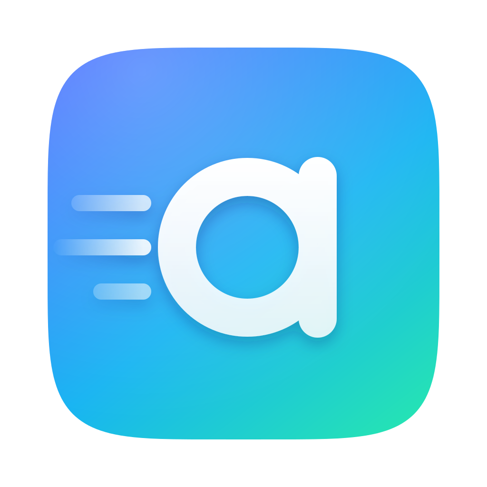

<p align="center"></p>

<h1 align="center">aeroandroid</h1>
<p align="center"><b>Android apps as real Mac apps, on Apple Silicon and Intel Macs.</b><br>
Double-click an <code>.apk</code>. It installs like a <code>.dmg</code> app, shows up in Launchpad and the Dock,<br>
and opens in its own window with nothing else on screen.</p>

---

## What you get

1. **Download an `.apk`, double-click it.** A small installer appears, installs the app into the Android subsystem and
   saves a Mac app for it in `~/Applications`. That app then opens by itself.
2. **Every Android app is a normal Mac app.** Own icon, own Dock tile, ⌘-Tab, ⌘-Q, Launchpad and Spotlight.
   Opening it shows only that app's window. No manager window, no emulator window.
3. **Ready out of the box.** The full edition ships with microG, [Aurora Store](https://auroraoss.com) and
   [Fennec](https://f-droid.org/packages/org.mozilla.fennec_fdroid/) (Firefox) installed.
4. **Your Mac's camera works.** Android camera apps use the Mac's physical camera.

Under the hood it is the official Android Emulator running the AOSP Android image for your Mac's chip, with a native Metal
window per app, plus an Android-side bridge for input, clipboard and notifications.

## Install

Requires a Mac (Apple Silicon, or an Intel Mac from 2018 on), macOS 14+, the Xcode Command Line Tools (`xcode-select --install`),
about 20 GB of free disk and an internet connection (about 1.8 GB of Android runtime plus the apps).

```bash
./build.sh                # Android 17: AOSP + Magisk root + microG + pre-installed apps
./build.sh --android 16   # Android 16 instead
./build.sh --pure         # AOSP only: no Magisk, no microG, no GPL-3.0 parts
./build.sh --mirror cn    # mainland China: GitHub via proxy, Android SDK via Tencent mirror
```

**Android 17** (API 37) is the default: Google's stable `android-37.0` image (arm64 or x86_64) and emulator 37.2.13, pinned in
`scripts/runtime-lock-17.json` (`-x86_64` for Intel). Root uses Magisk v31.0, the first release with Zygisk for API 37; Vector and microG
are the same pinned builds as on 16. The microG signature module hooks `ComputerEngine`, whose methods are unchanged
in Android 17 (checked against `android-17.0.0_r1`); `build.sh` only widens its Android-16-only gate to admit API 37.
**Not yet run on a Mac.** If the Android 17 install fails, `build.sh` offers to retry on Android 16, which stays
fully supported.

The installer saves a Quick Boot snapshot at the end, so the first app you open starts in seconds instead of
cold booting (the snapshot takes disk space about equal to the memory setting).

After the build, `Android Subsystem.app` is in `~/Applications`. Open it once: that makes the APK installer
the default app for `.apk` files. From then on, double-clicking any APK is all it takes.

## Signing and downloads

Release builds are signed ad hoc (free, no Apple Developer account), including the installer helper and the DMG,
so macOS does not call the app "damaged". Without a paid Developer ID and notarization macOS still says it cannot
verify the developer: right-click the app and choose Open, or run
`xattr -dr com.apple.quarantine "/Applications/Android Subsystem.app"`. Mac apps the subsystem creates for your
Android apps are made and signed on your own Mac, so they open without any prompt.

## How it fits together

One executable plays three roles, chosen by its `Info.plist`:

| Role | Where | What it does |
|------|-------|--------------|
| Manager | `Android Subsystem.app` | Library, files, settings, menu bar item |
| APK installer | `Android Subsystem.app/Contents/Helpers/APK Installer.app` | Owns `.apk`; installs, builds the Mac app, opens it, quits |
| Android app | `~/Applications/<App name>.app` (one per app) | Starts the subsystem if needed and shows that app's window |

| Path | Role |
|------|------|
| `macos/` | The Swift app: windows, Metal rendering, the three roles (`main.swift`, `AppMode.swift`) |
| `guest/` | Java bridge inside Android: frame transport, input method, notifications, clipboard, app icons |
| `backend/subsystem.py` | Controller: boots the emulator, installs APKs, builds the Mac apps (`install-app`) |
| `scripts/` | Build, provisioning (Magisk, microG), pre-installed apps (`preinstall.json`), logo generator |
| `assets/` | Logo (`logo.svg`, `logo-1024.png`) and `AppIcon.icns` |

## Intel Macs

An Intel Mac gets everything above. `build.sh` detects the chip (also when run in a Rosetta shell on Apple Silicon)
and installs the x86_64 emulator, system image, JDK, scrcpy and Python, each pinned by SHA-256 in
`scripts/runtime-lock-x86_64.json` / `runtime-lock-17-x86_64.json`. Magisk, Vector and microG already ship x86_64
code. The release DMG is a universal binary.

- **Android apps with arm64-only native code.** Many games ship only arm64 libraries. Whether the stock x86_64 image
  translates them is not confirmed: after the first boot, Settings → Check runtime environment shows the system's
  CPU types ("Android CPU types"). If `arm64-v8a` is not listed, those apps will not run on an Intel Mac.
- **Warning.** On an Intel Mac, `build.sh` prints this notice, the app shows it the first time it opens, and an app that
  cannot run because of its CPU type is refused with a plain explanation instead of a cryptic install error.
- **Speed.** Intel Macs run the x86_64 guest with the hypervisor too, but expect less performance than Apple Silicon.
- **Not tested on an Intel Mac.** Written and checked without one.

## Gaming

- **Controllers.** Plug in or pair an Xbox, PlayStation, Switch Pro or MFi controller. The window you are playing in
  sends it to Android as a gamepad: buttons as gamepad keys, sticks, triggers and the D-pad as joystick axes.
  Settings → Game controller lets you remap each button or switch controller input off. Games that read the input
  event see a gamepad; a game that lists connected input devices at startup may not, because Android here has no
  real controller hardware.
- **Graphics.** Android runs on the Apple Silicon hypervisor and renders with the Mac's GPU: "Automatic" already picks it,
  and Settings → Graphics acceleration can force it. Up to 60 FPS can be selected.
- **Limits.** Frames still reach the Mac as raw pixels over a local connection, which is the ceiling for fast games, so
  60 FPS is a cap and not a promise. Hardware video encoding would lift it but is not built yet.

## Pre-installed apps

microG (Services, Companion, GSFProxy) is provisioned by `scripts/provision-microg.py`. Aurora Store and Fennec
come from `scripts/preinstall.json`, pinned by APK and signing-certificate SHA-256; nothing unpinned is installed.
Add more with `python3 scripts/preinstall-apps.py --pin <https APK url>` and paste the printed entry.

microG is an open-source compatibility layer, not Google Play services: a successful install does not guarantee
that every Google API, Play Integrity or banking app works. See [docs/MICROG.md](docs/MICROG.md).

## Known limits

- macOS 14+ on Apple Silicon or Intel. Android 17 (default) or 16, AOSP. Android 17 root and microG are new and untested on a Mac.
- The subsystem keeps running in the background after you close an app's window; stop it from the menu bar item.
- Camera: the Mac camera is passed to the emulator as `webcam0` for both the front and back camera.
  macOS asks for camera permission the first time.
- Several `.apk` files opened together are installed as one split-APK set.
- Not GApps: no Google Play Store, Chrome or proprietary DroidGuard.

## Not included in this repository

The `microg-spoof/` module and Magisk's `host_patch.sh` are GPL-3.0 and are fetched by `build.sh` from upstream
for the full edition (checksummed, with a notice); they stay GPL-3.0. Prebuilt APKs and the runtime cache are
produced by the build scripts.

## License

Apache-2.0, Copyright 2026 daniel.ye. See [`LICENSE`](LICENSE) and [`NOTICE`](NOTICE) for third-party components.
